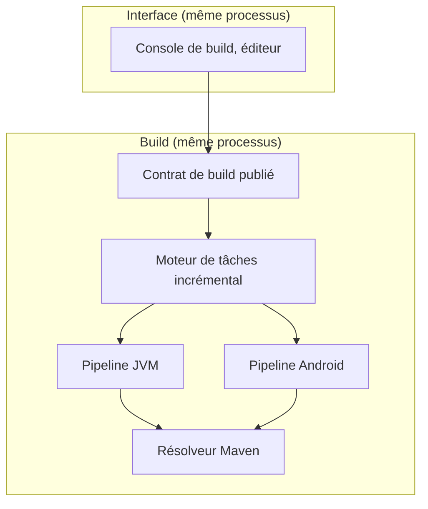
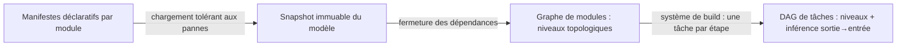
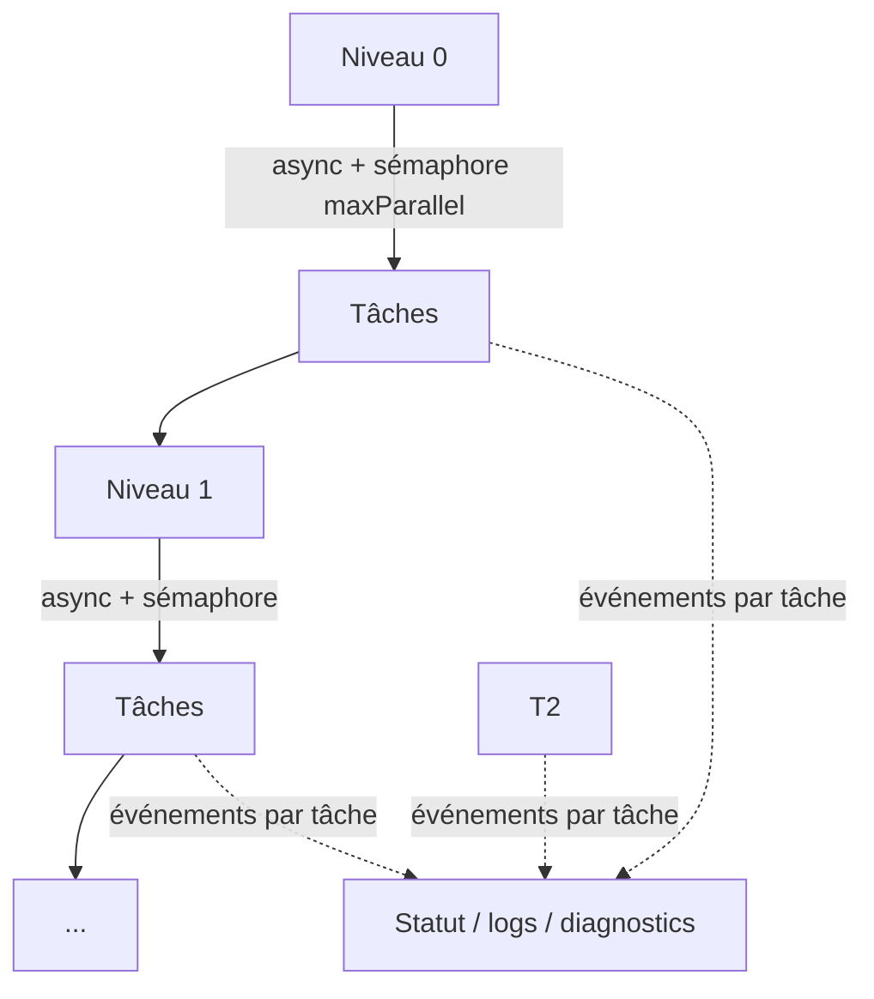
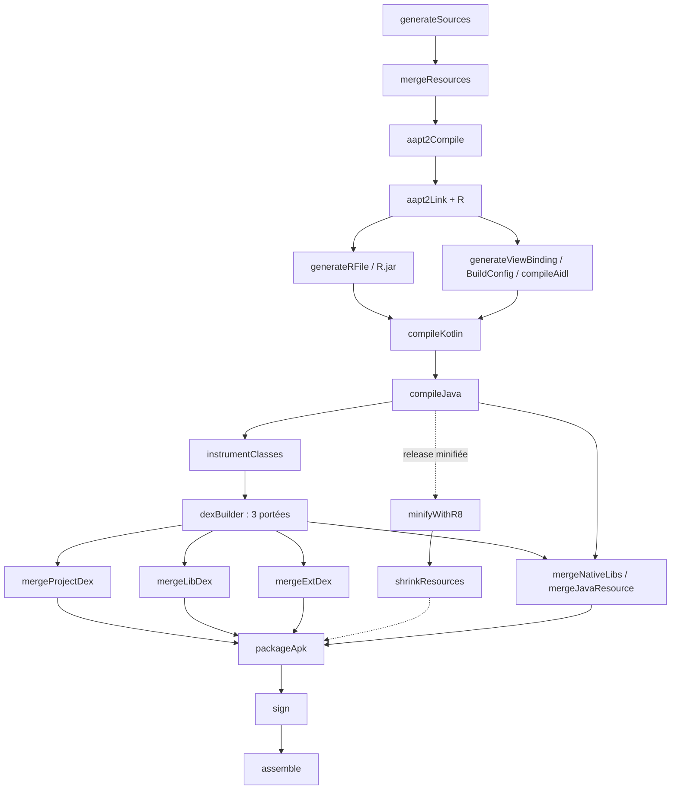

# Analyse du moteur de build de référence

> Phase 1 du plan de travail. Toutes les affirmations sur le moteur de référence sont justifiées
> par un identifiant `REF-xxx` dont le détail (fichier, plage de lignes, SHA épinglé) vit dans
> [`REFERENCES.md`](REFERENCES.md). Ce document ne cite jamais le moteur de référence par son nom,
> son auteur ou ses chemins.

## Méthodologie

L'analyse a été menée sur le commit épinglé du moteur de référence (voir `REFERENCES.md`,
paramètres d'épinglage) par lecture directe du code — la documentation du projet, bien que riche,
présente des diverrences avec le code (REF-059, REF-104, REF-124) qui auraient faussé une
cartographie fondée sur elle seule. Les constats de volume, d'algorithme et de comportement
proviennent des sources ; l'acyclicité du graphe de modules a été vérifiée par un script dédié
(REF-009). Ce qui n'a pas pu être vérifié est listé en fin de document.

## 1. Modules

Le moteur de référence est monorepo : 84 modules Gradle à chemins plats, mappés par couches de
répertoires (plateforme, langages, build, exécution, Android, services, plugins, interface)
(REF-009). La règle structurelle est « les dépendances pointent vers le bas uniquement » ;
notre vérification par script du graphe de dépendances de production (259 arêtes) **confirme
l'acyclicité** — les seuls cycles détectés passent par le harnais de test, hors dépendances de
production, ce que le dépôt documente explicitement (REF-009).

Les couches, du bas vers le haut (REF-004, REF-005) :

| Couche | Contenu | Ce qui nous concerne |
|---|---|---|
| Plateforme | Cœur sans connaissance du domaine : registre d'extensions, bus de messages, verrou modèle, hachage de contenu, VFS, modèle de projet | Socle du moteur |
| Build | Contrat de build publié, moteur de tâches incrémental, pipelines JVM et Android | Cœur du moteur |
| Langages | Backends Java (ecj), Kotlin (K2), XML ; compilation incrémentale | Pipelines de compilation |
| Android | Facettes, variantes, SDK, pipeline APK, AIDL | Pipeline Android |
| Services | Résolution de dépendances Maven | Résolveur |
| Interface | Console de build, pont moteur → UI | Console et diagnostics |

La frontière la plus importante pour nous : le **contrat de build** est un module publié séparé,
consommé par l'interface — c'est l'embryon de notre module `api/` (REF-002, REF-010). En
revanche, **tout s'exécute dans le même processus** que l'interface : l'isolation du build dans
un processus séparé n'existe qu'à l'état de design + instrumentation mémoire (Phase 0), les
phases suivantes n'étant pas commencées (REF-008). Notre architecture coquille + moteur
téléchargeable va donc structurellement au-delà de l'état du moteur de référence.

## 2. Modèle de projet

### 2.1 Hiérarchie de confinement

Workspace (projets ouverts, tables de bibliothèques et de SDK à l'échelle workspace) → Project
(une unité de build liée à **un** système de build) → Module (unité de compilation : type,
niveaux de langage, source sets, facettes, dépendances ordonnées, sorties) → SourceSet →
ContentRoot, un répertoire étiqueté par des **rôles** ouverts (source, ressources, ressources
Android, AIDL, assets, bibliothèques natives, généré, exclu) (REF-100). Les types de modules et
les scopes de dépendances sont eux-mêmes des points d'extension ouverts (REF-100, REF-101).
Les domaines (Android, Kotlin) attachent leur configuration via des **facettes** persistées,
décodées par des codecs enregistrés — le cœur du modèle ignore tout d'« Android » (REF-100).

### 2.2 Les deux graphes

Le modèle maintient deux graphes distincts (REF-103) :

- le **graphe de projets** (niveau workspace) : un DAG de projets, chaque nœud portant son
  système de build ; les arêtes sont dérivées des dépendances de modules inter-projets ;
- le **graphe de modules** (par projet) : un DAG des modules, fournissant les niveaux
  topologiques (Kahn) et la recherche de **dépendances inverses** pour la reconstruction
  incrémentale ; les cycles sont détectés par composantes fortement connexes (Tarjan).

Deux promesses de cette structure restent toutefois **inexécutées** dans le code : la politique
de coordination multi-projets (`PARALLEL_BY_LEVEL`, etc.) et la substitution de dépendance
(coordonnée externe → projet frère) sont des API sans aucun consommateur de production — un
build demandé construit et exécute le graphe de tâches d'un seul module/variante, sans
orchestration workspace (REF-104, REF-105). La doc décrit une orchestration en couches
imbriquées qui n'existe pas dans le code.

### 2.3 Transformation du modèle déclaratif en DAG de tâches

Le modèle est déclaratif (manifeste TOML par module, sans interpréteur de script sur le chemin de
synchronisation — REF-107). La transformation en DAG se fait à chaque demande de build : le
système de build sélectionné construit le graphe de tâches de la **fermeture transitive** des
dépendances du module cible (arêtes seulement si le scope est compile ou runtime), une tâche par
étape lifecycle par module, les dépendances inter-modules câblées par nom (REF-050, REF-051,
REF-060). La justesse du classpath vit dans le modèle, pas dans les pipelines : l'assemblage
(déduplication ordonnée, `api` vs `implementation` par le drapeau `exported`, SDK en
compile-only filtré du runtime, résolution de conflits « la plus récente gagne » sur le layout
Maven du cache, lecture d'une bibliothèque « comme son module déclarant l'a résolue ») est
calculée une fois et consommée par tous (REF-102, REF-114).

### 2.4 Mutation, persistance, concurrence

Les lectures voient un snapshot immuable ; les mutations passent par des transactions (staging
dans des builders, commit **sous verrou d'écriture** avec normalisation, génération monotone et
lot d'événements typés publiés sur le bus) ; `dispose()` sans commit est un rollback (REF-106).
La persistance est crash-safe : écriture temporaire puis renommage atomique, chargement à
tolérance de pannes (module illisible omis et signalé, tables dérivées reconstruites, **rien
d'endommagé n'est réécrit**, échec d'ouverture seulement si le manifeste workspace est
invalide ou d'une version future) (REF-107, REF-108). Trois faiblesses sont relevées : le
drapeau `exported` est silencieusement réécrit en une pure fonction du scope au commit (piège
d'API, REF-109) ; une fenêtre de **lost-update** existe entre transactions concurrentes (base
capturée à l'ouverture, pas de contrôle de génération au commit, REF-110) ; les événements sont
publiés en synchrone sous le verrou d'écriture et la discipline de « read actions » documentée
n'est appliquée nulle part (REF-112).

## 3. SPI de système de build

Le contrat (REF-010) sépare proprement trois rôles :

- **Construire** : `createBuildGraph(projet, requête, contexte)` retourne un DAG de tâches
  exécutable ; `supports(type de module)` ; `tasks(projet)` énumère les cibles proposées à
  l'utilisateur.
- **Lire un modèle étranger** : SPI séparé d'import (`detect`, `ownership`, `syncFiles`,
  `resolve`) qui retourne un **snapshot déclaratif** — l'importeur ne touche jamais au modèle
  vivant ; l'hôte applique la photo en une transaction, enregistre l'empreinte des fichiers lus
  (un changement plus tard affiche « resynchronisation nécessaire ») et fusionne les dépôts
  déclarés (REF-016).
- **Étendre un graphe** : les plugins de build reçoivent le conteneur de tâches et câblent leurs
  tâches par **nom** aux étapes lifecycle qu'ils ne possèdent pas, dans les deux sens ; un plugin
  qui lève est **sauté et signalé**, jamais un build cassé (REF-013, REF-014).

La sélection du système de build se fait par identifiant de projet (contribution), sinon par
type de module (built-ins puis contributions) (REF-015). Les points d'extension couvrent aussi
les types de modules, les backends de langages, les plugins du compilateur Kotlin (filtrés aux
seuls embarqués — contrainte des magasins sur le code téléchargé, REF-018) et les générateurs
de sources (REF-013).

Ce découpage en trois rôles est la leçon d'architecture la plus importante pour notre `api/` :
notre contrat, plus étroit (lancer/suivre/annuler/état/version, REF-010), en gardera la
discipline « le lecteur de modèles ne mute jamais le modèle ».

## 4. Moteur de tâches

### 4.1 Contrat

Une tâche déclare un nom, des **entrées typées** (fichiers, répertoires — ceux-ci seulement sur
l'implémentation, une asymétrie d'API relevée —, propriétés, classpath), des **sorties typées**
(fichiers, répertoire), des dépendances dures (`dependsOn` : un échec bloque) et des relations
d'ordre pures (`mustRunAfter`/`mustRunBefore` : ordre sans blocage), et s'exécute via une
fonction suspendante recevant un contexte (progression, vérification d'annulation, journal,
puits de diagnostics) (REF-011, REF-012). Une tâche sans aucune entrée est `NO-SOURCE` et sautée
(sauf opt-out explicite `AlwaysRun` réservé aux tâches d'exécution) (REF-019, REF-023).

### 4.2 Construction du DAG

Les arêtes dures unissent les dépendances déclarées, le câblage externe du conteneur, et des
arêtes **inférées producteur→consommateur** : si un chemin de sortie d'une tâche chevauche une
entrée déclarée d'une autre (par préfixe de chaîne — un défaut relevé : la comparaison n'est pas
bornée aux segments de chemin), l'arête est ajoutée sauf si elle inverserait une dépendance
explicite ou fermerait un cycle (garde par DFS par arête candidate, correctif d'une régression
réelle documentée) (REF-020). Le tri topologique est un Kahn par niveaux ; un cycle lève une
exception portant le cycle trouvé (REF-020). Le conteneur est paresseux : factories, résolution
par nom avant enregistrement, `configureEach` ; les configurations d'une tâche jamais enregistrée
sont silencieusement ignorées (REF-021).

### 4.3 Exécution

L'exécuteur parcourt les niveaux topologiques séquentiellement et lance les tâches d'un niveau
en parallèle borné par un sémaphore (REF-022). L'échec d'une tâche **bloque transitivement**
ses dépendantes (statut `Blocked`) mais les branches indépendantes continuent — pas de fail-fast
global (REF-027). Une tâche qui **lève** (au lieu de retourner un échec) est convertie en échec
rapporté : bannière FAILED, cause en une ligne, trace plafonnée à 80 lignes archivée en DEBUG
et dans le log plateforme — le build n'est jamais silencieux et l'utilisateur ne voit jamais un
mur de stack trace (REF-024). L'annulation est **coopérative uniquement** (vérification au
démarrage de chaque tâche + relais des exceptions d'annulation) ; les sous-processus éventuels ne
sont pas nettoyés par le moteur (REF-022, REF-088). Le parallélisme est **codé en dur à 2** par
l'hôte, indépendamment des cœurs et de la mémoire (REF-022).

### 4.4 Statuts, journal, plomberie

Chaque tâche streame ses statuts (`Running/UpToDate/NoSource/Succeeded/Failed/Blocked`) via un
unique canal d'événements ; le moteur **tamponne automatiquement** chaque entrée de journal et
chaque diagnostic du nom de la tâche courante — les producteurs ne connaissent pas leur propre
nom (REF-027, REF-028).

## 5. Incrémentalité

### 5.1 Empreintes

L'oracle up-to-date : avant d'exécuter une tâche, le moteur recalcule **à la volée** l'empreinte
de ses entrées **et celle de ses sorties existantes**, et les compare au magasin persisté ; en
cas d'égalité la tâche est sautée ; sinon exécutée puis le magasin est mis à jour (uniquement
sur succès) (REF-023). Les sorties supprimées ou modifiées à la main invalident donc la tâche.

L'empreinte (REF-030) : SHA-256 hexadécimal ; par groupe d'entrées (clés triées, fichiers triés
par chemin — déterminisme) ; un digest de contenu par fichier, servi par un **cache de digests**
clé = chemin, réutilisé si taille + mtime + fileKey inchangés, avec une **fenêtre anti-race de
2 s** (le hachage d'un fichier écrit il y a moins de 2 s n'est pas réutilisé) ; les répertoires
sont parcourus (sans suivi des liens symboliques — un défaut relevé : un symlink de répertoire
contribue zéro octet), les fichiers triés puis empreintés ; les propriétés sont hachées par
`toString` (deux valeurs de types différents de même rendu sont indistinguables) ; le classpath
par kind + chemin **dans l'ordre, sans contenu** (un jar remplacé au même chemin ne change pas
l'empreinte — et cette entrée de classpath n'est utilisée par aucune tâche du dépôt : API morte
en pratique) (REF-030, REF-031, REF-033, REF-034).

### 5.2 Magasin persistant

Un **fichier texte par tâche** (deux lignes : empreinte d'entrées, empreinte de sorties), sous
un répertoire de caches du projet (REF-025). La lecture est tolérante (fichier court ou illisible
→ absence → re-exécution : jamais de faux up-to-date) ; l'écriture est **non atomique** (pas de
temp+rename, pas de version de format) et le nom de fichier est produit par une sanitisation
**non injective** (deux noms de tâches distincts peuvent partager leur fichier d'empreintes)
(REF-025, REF-026). Le magasin n'est **pas borné** : aucune éviction des tâches disparues. Il
n'existe **pas de cache de sorties générique** au niveau du moteur : la doc annonce un second
étage « cache de sorties avec éviction LRU sur appareil », mais seuls les caches spécialisés du
pipeline Android (dex) correspondent à cette description (REF-081, REF-092).

### 5.3 Compilation Java incrémentale (sous la tâche)

Sous l'up-to-date par tâche, la compilation Java a sa propre couche incrémentale : manifeste
parallèle aux sorties, hachage de contexte (niveau de langage, bootclasspath, classpath — ABI
des répertoires, chemin+taille+mtime des jars), **chemin rapide** : seules les sources sales
sont compilées dans un répertoire de staging, avec la sortie existante en tête de classpath
(le compilateur résout les types sources avant le classpath, la copie périmée n'est jamais
lue) ; le commit du fast-path n'a lieu que si aucune classe produite n'écrase une classe d'une
source propre, si aucun ABI n'a changé, si aucune classe n'a disparu et si **aucun nouveau nom
simple** n'apparaît dans le texte des sources propres (détection par expression régulière,
biais conservateur) ; sinon full. Un échec de full conserve les sorties partielles et supprime
le manifeste : le prochain build sera full (auto-réparation) (REF-035, REF-036).

### 5.4 Invalidation entre modules

Le changement de sortie d'un module amont est une entrée (répertoire ou jar) des tâches aval :
la chaîne d'empreintes propage la recompilation **aux seules tâches concernées** — c'est
vérifié par leur test de référence : éditer une bibliothèque d'un projet de 14 modules ne
relance que 4 tâches (REF-152). Le graphe de modules offre aussi les dépendances inverses,
sans consommateur de production (REF-104).

## 6. Pipeline Java

Pour les modules `java-lib`/`java-cli`, le graphe par module est :
`generateSources` (si générateurs) → `compileKotlin` (enregistré dès qu'un compilateur Kotlin
est disponible, même sans `.kt` — le code peut être généré) → `compileJava` →
`processResources` → `classes` (agrégat) → `jar` (selon l'objectif) → `assemble`, plus une
chaîne de tests complète dépendant des `classes` du module et de ses dépendances de test
(REF-050, REF-051). Les dépendances inter-modules sont câblées sans condition : la compilation
du module dépend des compilations Java **et** Kotlin de ses dépendances (REF-051).

- **Compilation** : ecj **en processus**, via le front-end batch redéfini (un collecteur
  remplace le consommateur de résultats) ; options : `--release N` si la table des symboles
  existe, sinon `-source/-target`, `-g`, **`-nowarn` et `-proc:none` (aucun processeur
  d'annotations Java — une limite explicite)** ; sur ART, le bootclasspath est le classpath
  (qui porte `android.jar`), et une variante « sans image système » du compilateur construit
  son environnement de noms à la main (ensemble de paquets pré-calculé depuis les jars —
  ré-ouverts à chaque compilation, un coût relevé) (REF-052, REF-054).
- **Diagnostics** : par l'API du compilateur (jamais de re-parse du texte quand l'API existe) :
  chaque problème catégorisé devient un diagnostic structuré avec **code stable** (ids ecj
  mappés), colonne recalculée depuis les séparateurs de ligne, et **extrait de la ligne
  fautive** (REF-053).
- **Modules mixtes** : sorties Kotlin dans un répertoire **sibling** (`kotlin-classes`), jamais
  mélangé aux sorties Java ; Java reçoit les sorties Kotlin (siennes + amont) sur son classpath ;
  Kotlin reçoit les `.java` du module en entrées de **résolution** (pas de compilation) —
  l'interop fonctionne dans les deux sens (REF-055).
- **Packaging** : jar écrit avec un manifeste **toujours** présent (sinon ART refuse un zip vide
  et le jar n'est pas exécutable), `Main-Class` résolu au mieux, doublons éliminés, répertoires
  postérieurs gagnants ; les ressources sont copiées sans filtrage ; une tâche d'agrégat sans
  travail ne vit que par ses entrées trackées (REF-051, REF-066).
- **Exécution des programmes** : plus de fork `java` ni de dex de run (le design décrit par la
  doc a été **supprimé** — divergence majeure doc/code, REF-059) : le bytecode est **interprété**
  sur une VM interne embarquée, dans un thread dédié, avec redirection process-globale des
  flux standards (sûre uniquement parce que les runs sont séquentiels), une fin de run à la
  sémantique JVM (attente des threads non-daemon, des fenêtres), un arrêt borné à 2 s, et un
  pont qui convertit `System.exit` en exception contrôlée et **médie un bac à sable « curated »**
  (réseau, fichiers, réflexion, processus) via un broker de permissions à invite utilisateur ;
  les sous-processus engendrés par le programme ne sont jamais détruits (fuite relevée)
  (REF-056, REF-057).
- **Tests** : découverte JUnit 4/5/TestNG par lecture bytecode des `.class` compilés (tous
  chargés en mémoire — coût relevé), formes non pilotables explicitement écartées avec raison ;
  un **runner est généré en bytecode sans aucune réflexion**, protocole de rapport par stdout
  avec marqueur de contrôle (forgeable par un programme malveillant — relevé) (REF-058).

## 7. Pipeline Android

### 7.1 Graphe de tâches

Fidèle à la forme de l'outil de référence du secteur (REF-060) :

Debug : chaîne dexBuilder → merges par portée (projet / sous-modules / externe) ; release
minifiée : la chaîne est **remplacée** par une unique passe R8 puis la conversion retour des
ressources si rétrécissement activé (REF-060, REF-084). Un module android-lib construit un AAR
terminal (`assembleAar`) (REF-071).

### 7.2 Variantes

Produit cartésien types de build × combinaisons de saveurs (une par dimension), noms
lowerCamel ; source sets **partagés** (non-qualifiants) compilés par toutes les variantes juste
après `main` ; une bibliothèque est construite **dans la variante du consommateur** (même type
de build d'abord, meilleur recouvrement des saveurs, sinon variante par défaut) ; les
dépendances qualifiées par variante (`debugImplementation`) sont filtrées du classpath ;
applicationId + suffixes ; variante active persistée par module (REF-072).

### 7.3 Ressources et manifestes

- `mergeResources` : les `values` sont fusionnés **par entrée** (clé qualificateur|balise|type|nom,
  dernier qui gagne ; `<declare-styleable>` par union avec « richesse » prioritaire), les autres
  fichiers par **identité de ressource** (le tenant précédent d'un autre nom est supprimé) ;
  priorité croissante modules < AAR < application ; un XML non parsable est recopié tel quel ;
  une **carte de provenance** persistée remappe les erreurs de l'outil vers le fichier et la
  ligne **source utilisateur** (REF-061, REF-062). La fusion est **reconstruite intégralement à
  chaque exécution** (pas de fusion incrémentale par fichier — écart de performance relevé)
  (REF-061).
- Manifestes : fusion maison complète (identité par type+clé, tous les marqueurs `tools:node`,
  placeholders avec erreur si non résolu dans un identifiant, plancher `minSdkVersion` des
  bibliothèques vérifié avec échappatoire `overrideLibrary`, noms de classes relatifs résolus
  contre le package de la bibliothèque, namespace injecté) ; **tolérante là où l'outil de
  référence du secteur erre** (conflit d'attribut : le plus haut gagne + avertissement) ;
  parseur durci contre les entités externes (REF-064).
- R : génération **directement en bytecode** (sans passer par le compilateur Java) : R final
  complet pour l'application + R non-transitifs par bibliothèque valorisés depuis la table
  finale ; le R.jar est dexé dans son propre scope et fusionné dans la **couche projet** — une
  modification de ressource ne re-dexe jamais les bibliothèques externes ; horodatage fixe des
  entrées (déterminisme des caches) (REF-065).
- Générateurs : ViewBinding (émission Java source depuis les layouts du module), BuildConfig
  (champs dans l'ordre et la précédence de l'outil de référence), AIDL **compilateur pur**
  (génération `IInterface`/`Stub`/`Proxy`, marshalling longueur-préfixé, imports des dépendances
  sans régénération, classification des types framework par sonde bytecode) (REF-073, REF-074).

### 7.4 Packaging, signature, installation

- Packaging APK **pur Java** : fast path par copie brute d'octets (lecture du central directory,
  entrées de l'outil de ressources copiées sans décompression — `resources.arsc` jamais
  déflaté —, réutilisation des entrées de l'APK précédent identiques par taille+CRC via un
  cache), fallback ré-encodage complet ; ordre d'écriture strict (outil de ressources → dex
  renumérotés → profils stockés → assets → `lib/<abi>` → ressources Java, l'outil gagne les
  collisions) ; `noCompress` par suffixe insensible à la casse avec les défauts du secteur ;
  zips déterministes (dates fixes) ; les noms d'entrées venant de jars de dépendances ne sont
  **pas** sanitizés (un `../x` transite — relevé) (REF-066, REF-067).
- Règles de conflit : `exclude > merge > pickFirst > défaut` (premier gagne + avertissement, le
  secteur erreur) ; **concaténation** des `META-INF/services` ; exclusions par défaut fidèles
  (signatures, manifestes de jars, métadonnées Maven, modules Kotlin) ; fusion des
  bibliothèques natives (jniLibs, `jni/` des AAR, `.so` dans les jars, classifiers
  `natives-<abi>` dépaquetés) et des ressources Java (jar vide = archive canonique de 22 octets,
  ART refusant un zip à zéro entrée) (REF-067).
- Signature : bibliothèque apksig **en processus** sur appareil (v1+v2, v1 omise au-delà d'un
  certain minSdk, alignement 4 octets par le signeur — le packeur n'aligne pas) ; sur desktop,
  outil externe avec **mots de passe en clair sur la ligne de commande** (relevé) (REF-068).
- Keystores : registre applicatif (mots de passe **en clair au repos**, écriture atomique), seul
  l'identifiant vit dans le module ; keystore debug partagé standard (REF-069).
- Installation : **registre des APK signés par le build** (ledger SHA-256) — l'installeur refuse
  un APK que le build n'a pas produit ; session `PackageInstaller` avec confirmation
  utilisateur obligatoire sous Android 12+, abandon des sessions périmées (REF-070).

### 7.5 Chaîne dex

C'est la partie la plus sophistiquée du moteur (REF-080 à REF-092) :

- **Trois portées** (projet / sous-modules / bibliothèques externes) + R.jar séparé ; la portée
  projet est incrémentale **par fichier classe** (manifeste de hachages, classes inchangées
  servant de classpath de désugarage) ; les portées bibliothèques sont des **buckets par
  empreinte de contenu de jar** ; **vérification post-dex** que chaque classe dexable a bien
  produit un `.dex` (un dexer peut « réussir » en silence en droppant des classes) ; les `R`
  périmés sont exclus de la portée projet (l'autorité est le R.jar) (REF-080).
- **Caches à trois niveaux** avant l'outil : bucket du module inchangé → cache **inter-projets
  adressé par contenu** (une bibliothèque donnée est dexée une fois par machine, pas une fois
  par projet) → l'outil ; clé = minApi + mode + **tampon de version de format de cache** (à
  bumper à chaque changement d'outil) + digest de l'univers de désugarage **uniquement si le
  désugarage s'applique** (sinon contenu seul) ; les univers sont scopés (une bibliothèque
  externe ne désugare jamais contre le code du projet) (REF-081).
- **Fusion multidex incrémentale** : distribution des classes en un nombre borné de buckets par
  hachage stable du chemin, **signature persistée par bucket**, seuls les buckets modifiés
  re-fondus ; seuils dépendant du minSdk ; déduplication par classe entre bibliothèques
  (premier bucket gagne) ; minSdk < 21 : fusion unique (REF-083).
- **R8** en une passe (remplace la chaîne), règles keep collectées dans l'ordre contractuel du
  secteur (outil de ressources → fichiers du type de build avec défauts résolus → règles
  consommateurs des bibliothèques → inline), mode full par défaut, mapping sorti, repli
  pass-through sans règles ; **repli OOM** mémorisé : R8 sur le projet seul, bibliothèques
  dexées par le pipeline debug (REF-084, REF-085). L8 : runtime de désugarage dexé **entier**
  (le rétrécissement contre les règles R8 droppe des helpers internes) (REF-086).
- **Mémoire** : tout l'en-processus vit sous le plafond de tas applicatif ; dimensionnement des
  workers par cœurs **et** tas (tas serré → monothread), porte de crédits de tas process-wide,
  `largeHeap` demandé ; les passes lourdes (fusion dex, R8) sont déléguées à des **VM forkées**
  hors plafond applicatif (découverte du lanceur, échelle de tas candidate validée par essai,
  budget de fourches = RAM ÷ tas clampé, **porte FIFO globale** aux fourches concurrentes,
  merges **batchés** par fourche, backoff après mort) ; les fourches **ne sont pas tuées à
  l'annulation** (relevé) (REF-087, REF-088, REF-089).
- **Fournisseurs de ressources partagés** : `android.jar` et les jars ouverts + indexés **une
  fois par processus** et réutilisés entre invocations (LRU mémoire) (REF-090). Diagnostics
  dex **humanisés** : stack frames supprimés, chemins internes raccourcis en noms de classes,
  signatures connues réécrites en une ligne actionnable (classe dupliquée, limite 64K,
  OOM, version de bytecode) (REF-091). Le cache dex disque n'a **ni quota ni éviction**
  (relevé) (REF-092).

## 8. aapt2 natif

- **Fourniture** : binaire natif par ABI, packagé comme bibliothèque `.so` dans l'application
  (avec extraction legacy) et exécuté depuis `nativeLibraryDir` — « le seul endroit où ART
  permet exec » ; le prebuilt est téléchargé à la **construction de l'IDE** depuis un dépôt
  tiers **sans somme de contrôle** (seuls l'en-tête ELF et une taille minimale sont vérifiés)
  (REF-063). Un daemon optionnel (protocole ligne-par-ligne, arrêt après inactivité) existe
  pour la prévisualisation (REF-063).
- **Invocation** : sous-processus, un process par répertoire de ressources pour `compile` ;
  `link` construit sa ligne d'options (package-id, manifeste, `--java`, `--custom-package`,
  `--extra-packages`, versions, `--non-final-ids` pour les bibliothèques, `--proguard` pour les
  règles keep dérivées des XML, `--proto-format` pour le rétrécissement, ids stables persistés
  avec repli sans ids en cas de conflit) ; `convert` pour le retour proto→binaire ; des tables
  incluses (`-I`) pour le lien des dépendances avec un id de paquet réservé jetable (REF-063,
  REF-065).
- **Diagnostics** : la sortie est fusionnée stdout/stderr, lue jusqu'à EOF puis attendue (pas
  d'interblocage de pipe), la mort par signal est décodée, un **self-test** (`aapt2 version`)
  distingue « binaire non exécutable (ABI) » d'« erreur d'entrées » ; le texte passe par le
  parseur générique (forme `path:line: error:`) puis les erreurs sont **remappées** vers les
  fichiers sources via la carte de provenance de la fusion (REF-042, REF-062, REF-063).
- **Limites relevées** : **aucun timeout** sur ces sous-processus (seul un tueur d'OOM sur ligne
  fatale existe) ; le binaire ne vient jamais de notre chaîne d'approvisionnement vérifiée
  (REF-063).

## 9. Résolution de dépendances

- **Algorithme** : BFS **par vagues** — la frontière est dépilée, les POM/métadonnées de la
  vague sont chargés **en parallèle** (sémaphore), le pliage du graphe est monothread ; bornes
  de sécurité (nœuds max 4000) **silencieuses** ; annulation vérifiée à chaque vague (REF-120).
- **POM effectif** : chaîne de parents (cycle gardé), `dependencyManagement` avec import de BOM
  récursif, surcharges locales de version **et** de scope, substitution de propriétés itérée,
  relocations ; parseur XML minimaliste avec **DOCTYPE rejeté** (défense XXE) et espaces de
  noms ignorés (REF-121).
- **Versions et conflits** : comparateur par jetons avec rangs de qualifieurs ; la stratégie de
  résolution est « **la plus récente gagne** » — y compris, de façon surprenante, sous la
  politique « échec sur conflit » qui **ne fait pas échouer** (les conflits sont seulement
  rapportés) ; alignements par familles (stdlib Kotlin, pour éviter les classes dupliquées au
  dex) et par contraintes GMM ; éviction par **capacités** (à la Gradle) ; élagage de
  l'inatteignable ; plages de versions résolues par les métadonnées publiées (la plus récente
  **stable** de la plage) (REF-120, REF-122).
- **Variantes Gradle Module Metadata** : sélection par attributs (plateforme android par
  défaut), union des dépendances **api + runtime** des variantes choisies (corrige de vrais
  `NoClassDefFoundError`), contraintes des deux, suivi `available-at` avec garde de cycle ;
  l'algorithme est assumé incomplet face à Gradle (REF-123).
- **Cache** : réplique du layout Maven — « le cache **est** le dépôt hors ligne » ; écritures
  **atomiques** (temp+rename, partiel supprimé à l'échec), cache négatif des 404 (TTL 7 jours,
  jamais pour erreur transitoire), AAR explosés à côté avec marqueur de version ; **aucune
  éviction** (contraire à la promesse de la doc d'API) (REF-124).
- **Sécurité du canal** : **aucune vérification d'intégrité des artefacts** (aucune somme
  contrôlée nulle part) ; HTTP accepté (dépôts utilisateur, import Gradle, et le suiveur de
  redirections suit un **downgrade https→http**) ; HTTPS seulement par défaut ; timeouts 15/30 s ;
  403 traité en transitoire ; pas de reprise `Range` (un échec = re-téléchargement complet)
  (REF-125, REF-126, REF-127).
- **AAR** : explosion avec **garde zip-slip**, marqueur de version, `libs/*.jar` fusionnés
  (premier gagne, services concaténés, signatures supprimées) ; il existe **deux extracteurs
  dupliqués** dans le dépôt (relevé) (REF-128).
- **Extras** : bibliothèques **pré-dexées signées** téléchargeables (cache distant de dex),
  installées seulement si complètes et si l'empreinte signée est vérifiée (REF-129) ; dépôts
  additionnels par fichier texte fusionné à l'import ; recherche dans les index publics.

## 10. Compilation Kotlin

- **Embarquement** : le compilateur K2 (publication « pour IDE », non relocalisée) est fusionné
  avec la plateforme IntelliJ en **un jar d'environ 65 Mo**, passé par des passes bytecode
  dédiées pour tourner sur ART (auto-localisation des chemins, tolérances Unsafe/VarHandle/
  records, coroutines remappées…) — 18 fichiers de passes, le coût réel de « du Kotlin sur
  ART » (REF-130, REF-135). L'environnement est maintenu chaud **sans libération possible**
  (durée de vie = session) (REF-134).
- **En processus** : appel direct du compilateur avec collecteur de messages (sévérité, chemin,
  ligne, colonne, extrait), stdlib bundlée, `android.jar` plié sur ART, PSI obligatoire ;
  plugins du compilateur (Compose, sérialisation, parcelize) bundlés et **activés par sonde de
  classpath** (présence d'une classe clé — pas de configuration) ; sur ART, le registrar du
  plugin est résolu par délégation parente, le jar ne servant que de descripteur de services
  (REF-130, REF-136).
- **Compilation incrémentale** : couche sous la tâche, manifeste à côté des sorties ; fast-path
  par fichiers sales (classes propres **hardlinkées**, copie compilée contre la sortie propre),
  retombée en full sur **tout doute** (façade multi-fichiers partagée, ABI d'une classe
  préexistante changé, classe disparue, échec du staging) ; l'ABI digère l'en-tête, les membres
  non privés et les métadonnées Kotlin complètes, et **une fonction inline fait hacher le
  fichier entier** (le corps est l'API) ; un full qui échoue supprime le manifeste
  (auto-réparation). L'empreinte du classpath de contexte est par **chemin+taille+mtime**
  (relevé : contenu non vérifié) (REF-131, REF-132).
- **Forké sur appareil** : alternative au in-process — pool de **VM forkées persistantes**
  (le classpath de la fourche est l'APK installé), protocole versionné sur stdin/stdout avec
  **payload sur disque**, canal protégé (le vrai stdout est détourné vers stderr pour qu'aucune
  ligne parasite du compilateur ne désynchronise le protocole, queue de diagnostic de 40
  lignes), diagnostics **structurés** (pas de re-parse), contournement d'un bug de JIT
  Android ≤ 11, pas de repli in-process après crash sur ces versions (REF-133).

## 11. Compatibilité Gradle

L'objectif est d'**ouvrir** un projet Gradle sans exécuter Gradle (les scripts étant
Turing-complets, l'extraction statique ne peut pas être parfaite) (REF-142). La stratégie :
parseur **tolérant** (accolades équilibrées en respectant les chaînes, commentaires masqués,
jamais d'exception), extraire la majorité déclarative conventionnelle, **signaler tout le
reste** dans un rapport de synchronisation plutôt que le jeter, et offrir des reprises
manuelles. Sont lus : settings (includes), plugins (y compris **conventions** de buildSrc et
du logic de build), le bloc `android` (SDK, namespace, types de build, saveurs, placeholders,
champs BuildConfig, noCompress), les dépendances (coordonnées avec classifier, `project()`,
`platform()`, catalogue de versions avec `version.ref` et accesseurs normalisés, `kotlin()`,
configurations qualifiées par variante), l'interpolation de variables multi-source, les
dépôts (fusionnés dans un fichier du projet, jamais écrasés) (REF-140, REF-141, REF-142,
REF-143). Les modules multiplateformes sont importés **une cible à la fois** (préférence
enregistrée, sinon hôte), les ensembles `dependsOn` repliés dans `main`, les racines communes
pour `expect`/`actual` (REF-145). L'écriture retour (ajout/retrait d'une dépendance depuis
l'interface) édite **une ligne** du bloc `dependencies` sur une copie masquée et refuse plutôt
que de deviner les déclarations multi-lignes (REF-144). L'export natif→Gradle existe aussi,
avec des notes pour tout ce qui n'a pas d'expression fidèle, et une **boucle de test
export→import** garantit que les deux directions restent d'accord (REF-145). Les limites sont
assumées et documentées : pas de logique de build personnalisée, pas de plugins exécutés.

## 12. Console et diagnostics

- **Deux canaux distincts** : le **transcript brut** (ce que les outils impriment, bannières
  d'étapes, verbeux) et les **diagnostics structurés** (sévérité, genre extensible, source,
  localisation 1-based, code, extrait, tâche) produits **en flux** par les API des outils —
  « demander à l'outil, ne pas parser sa sortie » : le compilateur Java par son API de
  problèmes (avec codes stables), le compilateur Kotlin par son collecteur de messages, D8/R8
  par son gestionnaire de diagnostics ; le parseur de texte n'est que le **repli** pour les
  outils qui n'impriment que du texte (outil de ressources, signeur, AIDL), avec humanisation
  préalable (déduplication des échos, réécriture des en-têtes d'exception) (REF-040, REF-041,
  REF-042, REF-053).
- **Niveaux** : DEBUG (détail des outils, cache hits, traces) caché par défaut derrière un
  bouton « verbeux » ; INFO (bannières `> Tâche :x [UP-TO-DATE]`, verdict final) ; WARN/ERROR
  (rendus depuis les diagnostics structurés) ; une ligne non typée n'est élevée en erreur que
  sur préfixe explicite (plus de faux positifs sur les chemins contenant « error ») ; le
  **copier** prend toujours tout le log, verbeux ou non (rapport de bug complet) (REF-041,
  REF-043, REF-044).
- **Interface** : onglets Problèmes / Journal / Étapes ; Problèmes groupé par fichier avec
  filtre de sévérité, extrait inline, **saut fichier:ligne** à l'éditeur, ouverture
  automatique à l'échec ; Journal groupé par tâche, repliable, recherche ; Étapes = statut
  réel par tâche y compris UP-TO-DATE/NO-SOURCE/SKIPPED (REF-044). Un défaut de performance est
  relevé : l'état de build est une liste immuable **recopiée à chaque ligne** (coût quadratique
  sur un build bavard) (REF-043).

## 13. Tests et benchmarks

- **Volume** : 2595 tests / 442 suites au dernier release ; par zone : moteur de tâches 50,
  pipeline Java 90, Android 584, résolveur 109, Kotlin 2081, pont interface 1075 (REF-153).
- **Catégories couvertes** (les noms de scénarios sont éloquents) : incrémentalité du moteur
  (zéro travail au re-run ; une édition ne relance que la sous-chaîne affectée), inférence de
  dépendances et détection de cycles (dont deux tests de régression documentant de vrais bugs
  corrigés), rapport d'échec, empreintes (réutilisation stat, fenêtre racy), fusion dex
  incrémentale, concurrence dex, keystore, daemon aapt2, tueur de sous-processus, résolveur
  (conflits, relocations, BOM, plages, GMM, capacités, **hors-ligne**, DOCTYPE refusé,
  re-téléchargement après échec), import Gradle (natifs/classifiers, catalogue, **rapport des
  références non résolues**, fusion des dépôts, boucle export→import) (REF-153).
- **Benchmarks** : tâche `regressionTest` dédiée (jamais up-to-date ni servie depuis un cache)
  sur tag JUnit, harnais à métriques typées (latence, allocations, tas, qualité) avec
  tolérances, verdicts et **baselines committées** ; la baseline emblématique : un projet de
  14 modules, build complet ~0,3 s, **une édition de bibliothèque ne relance que 4 tâches**
  (REF-150, REF-151, REF-152). Un benchmark d'instrumentation sur appareil réel existe
  (assembleDebug frais, dexBuilder chronométré) (REF-153).
- **Zones sans tests** (relevé) : annulation en cours de build, corruption du magasin
  d'empreintes, concurrence réelle de commits du modèle, annulation de la résolution,
  substitution et coordination (code mort), repli non atomique de l'écriture crash-safe
  (REF-154).

## Ce qui n'a pas pu être vérifié

- Les **comportements à l'exécution sur appareil réel** (temps de spawn des fourches, tas
  réellement accordé, tombstones, pics mémoire du R8 in-process) : les chiffres cités par le
  code viennent de commentaires et de mesures embarquées, non reproduits ici (REF-087).
- L'**exécution des suites de tests et des benchmarks** du moteur de référence : seuls les
  fichiers, les scénarios et les baselines committées ont été lus.
- Le **contenu exact des binaires et assets bundlés** (prebuilt de l'outil de ressources,
  keystores de debug, runtime de désugarage) : fichiers binaires non audités.
- Les modules expérimentaux et échantillons du dépôt de référence : hors périmètre du moteur
  de build.
