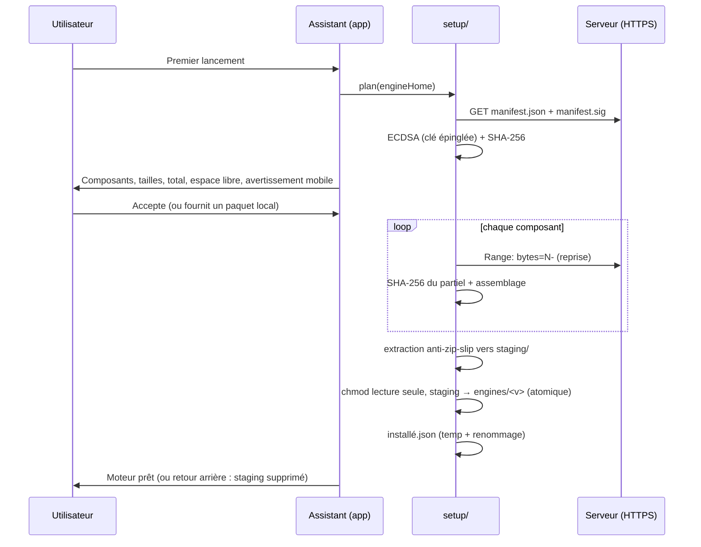

# Conception de Forge

> Phase 3 du plan de travail. Architecture cible en Java, détail de l'architecture coquille +
> moteur téléchargeable, améliorations évaluées et priorisées, ordre d'implémentation. Chaque
> renvoi `REF-xxx` désigne une entrée de [`REFERENCES.md`](REFERENCES.md) ; les constats
> `S-x`, `P-x`, `C-x`, `M-x` viennent de [`revue-moteur-build.md`](revue-moteur-build.md).
> Le « moteur de référence » y est décrit sans être nommé (règle du projet).

## 1. Objectifs et méthode

Forge reprend l'ambition constatée du moteur de référence — compiler, dexer, packager et signer
un projet Android **entièrement sur l'appareil**, sans Gradle ni ordinateur (analyse §7) — avec
trois différences structurelles :

1. **La coquille ne construit pas.** Toute la logique de build vit dans un moteur versionné,
   téléchargé et installé à la première exécution, exécuté dans un processus séparé. Le moteur
   de référence embarquait au contraire tout dans l'application monolithique ; son propre design
   documenté d'un service séparé n'a jamais été implémenté (REF-008).
2. **La chaîne d'approvisionnement est vérifiée.** Le moteur de référence télécharge jars, AAR et
   binaires sans aucune somme de contrôle et accepte HTTP (S-1, S-2, S-5) ; chez nous, rien
   n'est téléchargé, installé ou chargé sans vérification SHA-256 et signature.
3. **Les faiblesses constatées deviennent des exigences** : annulation de bout en bout sans
   processus orphelin (C-1), écritures atomiques généralisées (C-2, C-11, C-13), parallélisme
   calculé (P-3), reprise de téléchargement (P-4), diagnostics structurés qui traversent la
   frontière de processus.

Méthode : chaque décision ci-dessous est présentée en style « registre de décisions »
(contexte → décision → justification → alternatives rejetées), puis les composants sont
conçus en détail. Le document fixe ce que la Phase 4 implémente ; tout écart constaté pendant
l'implémentation sera consigné dans [`limites-et-suite.md`](limites-et-suite.md).

## 2. Vue d'ensemble

```mermaid
flowchart LR
    subgraph COQUILLE["Coquille (application Android, jo.forge.app)"]
        UI[Interface : projets,\nassistant d'installation, builds]
        FS[Service premier plan\nForgeHostService]
        CL[Client du moteur\njo.forge.client]
        INST[Installateur\njo.forge.setup]
    end
    subgraph API["api/ (contrat partagé, pur Java)"]
        P[Trames, messages,\nnégociation de version]
    end
    subgraph MOTEUR["Moteur (processus séparé, téléchargé)"]
        BOOT[bootstrap.EngineMain]
        CORE[Moteur de tâches\ngraphe, exécuteur, empreintes]
        PIPE[Pipelines\nJava, Android]
        RES[Résolveur de\ndépendances]
    end
    subgraph DISQUE["Stockage privé de l'application"]
        HOME[forge/engines/&lt;v&gt;/\nengine.jar + lib/ + bin/]
        STATE[forge/state/\ninstallé.json, empreintes]
        PROJ[Projets de l'utilisateur\n(stockage partagé)]
    end
    UI --> INST --> HOME
    UI --> FS --> CL
    CL <-->|"stdio : trames API"| BOOT
    BOOT --> CORE --> PIPE
    PIPE --> RES
    CORE <--> PROJ
    CL -.-> STATE
    CORE -.-> STATE
```

Principes directeurs :

- **Purité JVM du moteur, du client et de l'installateur.** `api/`, `client/`, `setup/`,
  `engine/` ne dépendent d'**aucune** API Android : ils se compilent et se testent sur JDK 17,
  puis s'exécutent sur ART. Les chemins, la mémoire totale et l'ABI sont *injectés* par la
  coquille. Seule `app/` touche Android. C'est ce qui rend le cœur testable en continu (le
  moteur de référence, testé surtout en JVM, réserve des surprises sur ART — REF-133) tout en
  restant honnête : ce qui n'a pas été vérifié sur appareil sera signalé.
- **Un seul canal d'exécution.** Tout ce qui tourne hors coquille est une machine virtuelle
  enfant lancée par le même mécanisme (`VmLauncher`), avec le même protocole de trames que le
  transport principal — un seul code à auditer, pas deux (leçon de la duplication constatée
  REF-128, M-5).
- **Les données volumineuses ne traversent pas le canal de contrôle.** Fichiers sources,
  classpaths, sorties et artefacts restent sur le disque (même UID) ; l'IPC ne porte que du
  contrôle et des deltas d'événements — invariant repris du design non implémenté du moteur
  de référence (REF-008) et adapté à notre transport.

## 3. Registre des décisions

### D-01 — Transport application ↔ moteur : trames sur les flux standards d'une VM enfant

**Contexte.** Le cahier des charges exige un moteur en processus séparé et demande de comparer
Binder/AIDL, Messenger et socket local. Le moteur doit rester pur Java (§2).

**Décision.** La coquille lance le moteur comme **processus enfant** (`app_process` sur
appareil, `java` en développement/tests) et communique par **trames binaires longueur-préfixées
sur les flux standard (stdin/stdout)** de l'enfant ; stderr est réservé aux diagnostics
d'écroulement.

**Justification.**

| Critère | AIDL/Binder | Messenger | Socket local (TCP 127.0.0.1) | **stdio + VM enfant** |
|---|---|---|---|---|
| Moteur pur Java (testable JVM) | non (API Android) | non | oui | **oui** |
| Confidentialité du canal | médium (services) | médium | **faible** (port joignable par toute app locale : il faudrait un jeton) | **fort** (tubes privés parent↔enfant) |
| Charge utile > 1 Mo | non (tampon Binder) | non | oui | **oui** |
| Contrôle du tas du moteur | non (plafond `dalvik.vm.heapsize`) | non | selon lancement | **oui** (`-Xmx` au lancement) |
| Détection de mort du moteur | binder mort | idem | EOF | **EOF + exit code** |
| Coût d'annulation propre | élevé | élevé | moyen | **faible** (SIGKILL du groupe) |
| Dépendance à des comportements OEM | faible | faible | faible | **moyen** (exécution d'`app_process`) — atténué par D-03 |

Le point décisif est la **souveraineté sur le tas** : compiler ou dexer demande des centaines de
méga-octets, or un processus applicatif Android est plafonné par `dalvik.vm.heapsize`
(≈ 576 Mo constatés sur l'appareil du moteur de référence, REF-087). Une VM enfant lancée avec
son propre `-Xmx` sort de ce plafond — c'est exactement la technique que le moteur de référence
utilise pour ses passes lourdes (REF-088, REF-089) ; nous l'étendons au moteur entier.
Second point : les tubes stdio sont **privés par construction** (pas de port local à protéger
contre les autres applications du téléphone), là où un socket TCP local exigerait un protocole
d'authentification par jeton. Troisième point : la mort du moteur est un simple EOF — pas de
lien binder à nettoyer.

**Alternatives rejetées.** AIDL : contrairait le contrat à des types Android et plafonnerait le
tas du moteur ; Messenger : sérialisation systématique et traitement un-à-un, inadapté au flux
d'événements ; socket : canal à sécuriser contre les applications locales pour un bénéfice nul
sur ce point. **Repli documenté** (D-03) : si un appareil empêche l'exécution d'`app_process`,
le même moteur démarre chargé par `DexClassLoader` dans un processus Android `:engine` et parle
le même protocole sur des tubes créés par la coquille — seul le lanceur change.

### D-02 — Modèle de processus : une VM moteur par session, des VM travailleuses par passe lourde

**Contexte.** Un crash ou un manque de mémoire dans le build ne doit pas faire tomber
l'interface (exigence) ; Android 12+ fait peser une menace spécifique sur les processus enfants
d'applications (tueur de « processus fantômes », limite système ~32, ciblage des enfants CPU
avides en arrière-plan).

**Décision.**

- La coquille exécute les builds dans un **service premier plan** (`ForgeHostService`,
  notification obligatoire — l'équivalent de ce que la feuille de route du moteur de référence
  prévoyait, REF-008). Ce service **supervise** le moteur : lancement, ping de vie, redémarrage
  au besoin, arrêt.
- Le **moteur** reste en vie entre les builds (caches et résolveur chauds) et **s'éteint de
  lui-même après un délai d'inactivité** (10 min par défaut, configuré) : moins de processus
  résidents, moins de surface pour le tueur de processus fantômes.
- Les passes lourdes (compilation Java, dex, plus tard Kotlin) tournent dans des **VM
  travailleuses** enfants du moteur, lancées avec leur propre `-Xmx` et détruites à la fin de la
  passe. Communication : les mêmes trames que D-01, sur les stdio du travailleur.
- **Budget de concurrence** : le nombre de travailleuses simultanées est plafonné à
  `min(cœurs − 1, RAM disponible / tas travailleur, 3)` — le moteur de référence codait
  « 2 » en dur (REF-022, P-3) ; nous le calculons et l'exposons dans les événements de build.

**Justification de l'écart avec le moteur de référence.** Il lance ses compilateurs dans des VM
forkées (REF-088) mais garde le *cœur* du build dans le processus de l'application : un OOM du
dex tuait l'IDE entier. Notre découpage (coquille | moteur | travailleuses) garantit
l'isolation exigée à chaque étage. Contre le tueur de processus fantômes : service premier plan
+ budget ≤ 3 travailleuses + extinction au repos + message à l'utilisateur (voir
[`distribution.md`](distribution.md) §8) décrivant l'option « désactiver les restrictions de
processus enfants » d'Android 14+ pour les gros builds.

### D-03 — Chargement du code téléchargé : jars dexés en lecture seule sur le classpath d'une VM enfant

**Contexte.** Le moteur est du code téléchargé après installation. Android exige que le code
chargé dynamiquement soit en **lecture seule** sur les versions récentes (jamais un fichier
ouvert en écriture), et le cahier des charges demande de trancher `DexClassLoader` contre
processus dédié.

**Décision.** L'artefact moteur est un **jar contenant `classes.dex`** (plus ses bibliothèques
compagnon, dexées elles aussi, dans `lib/`). Sur appareil, il est chargé **comme classpath d'une
VM `app_process`** : `CLASSPATH=engine.jar:lib/*.jar app_process -Xmx… /
jo.forge.engine.bootstrap.EngineMain`. L'installateur pose ces fichiers en **lecture seule**
(`0444`/`0555`) dès l'installation, et toute vérification d'intégrité a lieu **avant** le
chargement (D-05). Le repli, si un OEM bloquait `app_process` : `DexClassLoader` (parent =
chargeur de la coquille, `api/` partagé) dans un processus `:engine` declaré dans le manifeste
de la coquille — les jars restant en lecture seule hors usage.

**Justification.** Le chargement sur classpath d'`app_process` est le mécanisme par lequel le
système lui-même lance du code Java ; il est indépendant du `targetSdk` (aucune écriture
requise), et il donne D-01/D-02 (tas, isolement) gratuitement. `DexClassLoader` reste le
repli documenté : mécanisme standard des plugins, permis à tous niveaux d'API tant que le
fichier est en lecture seule. Dans les deux cas, la règle « vérifié avant chargement, lecture
seule au chargement » corrige S-1/S-2 pour le code du moteur lui-même.

### D-04 — Exécution des binaires natifs (`aapt2`) : `targetSdk 28` et binaire téléchargé, repli Java pur documenté

**Contexte.** Depuis Android 10, une application dont le `targetSdk` ≥ 29 ne peut pas
`execve()` un fichier de son stockage inscriptible (politique W^X de SELinux). Le moteur de
référence contourne en embarquant l'outil de ressources comme `.so` dans son APK et ne
l'exécute que depuis `nativeLibraryDir` (REF-063) — impossible pour nous : la coquille ne doit
embarquer **aucun** binaire d'outil, l'outil est un composant téléchargé.

**Décision.**

1. La coquille est publiée avec **`targetSdk 28`** (et `minSdk 28`). Un `targetSdk` ≤ 28
   préserve le droit d'exécuter des fichiers du stockage privé de l'application : le composant
   `aapt2-<abi>` téléchargé, vérifié (SHA-256 + manifeste signé, D-05) et posé en exécutable
   (`0555`) dans `forge/engines/<v>/bin/aapt2/<abi>/` est lancé par `ProcessBuilder` comme
   **enfant direct du moteur**.
2. Le **repli long terme** est écrit dès maintenant : l'interface d'invocation de l'outil de
   ressources (`ResourceCompiler`) est une interface du moteur, avec deux implémentations
   permises — `NativeResourceCompiler` (binaire, par défaut) et une future
   `PureJavaResourceCompiler` (compile/link en Java pur, à la manière de ce que le moteur de
   référence a déjà fait pour AIDL et la fusion de manifestes, REF-073/REF-064). Le jour où le
   `targetSdk` devra monter (ou pour une variante « boutique » sans code téléchargé), la
   bascule est un changement d'implémentation, pas d'architecture.
3. `minSdk 28` est inchangé : la restriction dépend du `targetSdk`, pas du `minSdk` (constat
   §5.1 de la revue).

**Justification.** Les alternatives ont été pesées : (a) livrer `aapt2` dans un APK compagnon
installable — impose `PackageInstaller` avec confirmation (REF-070), une icône parasite et la
même question de politique de distribution, pour un bénéfice nul hors Play Store ;
(b) tout réimplémenter en Java pur dès maintenant — des mois de travail pour couvrir
compile+link d'aapt2 alors que le binaire existe et fonctionne (le moteur de référence le
prouve, REF-063) ; (c) `targetSdk 28` — un cran de compatibilité documenté, cohérent avec une
distribution hors magasin (voir [`distribution.md`](distribution.md) §2 et §5 : Google Play
exige aujourd'hui un `targetSdk` bien plus récent **et** interdit de toute façon le
téléchargement de code exécutable hors Play). Le choix (c) est le seul qui respecte
l'architecture « coquille vide » du cahier des charges sans réécriture massive. Il est
assumé, documenté et accompagné de son plan de sortie (point 2).

**Garde-fous.** Le binaire n'est exécuté qu'après vérification d'intégrité (D-05) ; il est un
enfant direct du moteur (annulation = destruction, D-08) ; il est soumis au watchdog de D-09
(le moteur de référence n'en avait aucun — S-8) ; son ABI est validée contre l'ABI de
l'appareil avant tout lancement ; sa sortie n'est jamais interprétée comme code.

### D-05 — Manifeste signé et vérification systématique

**Décision.** Le manifeste des composants (`manifest.json`, D-06) est un fichier JSON signé :
la signature couvre **les octets exacts** du fichier (pas une re-sérialisation), algorithme
**ECDSA P-256 / SHA-256**, encodage DER, fichier compagnon `manifest.sig`. La clé publique est
**épinglée dans la coquille** (constante + ressource). Vérifications en cascade, toutes
bloquantes : HTTPS obligatoire (refus de `http://` et de toute redirection dégradante — corrige
S-2) → signature du manifeste → SHA-256 de chaque composant → (à l'installation) taille et
somme de chaque fichier extrait. Échec = rejet net + diagnostic explicite + re-téléchargement
une fois, puis échec propre.

**Pourquoi ECDSA P-256 et pas Ed25519.** Ed25519 via `java.security` n'est disponible sur
Android qu'à partir de l'API 33 ; `minSdk 28` l'exclut. ECDSA P-256 est disponible partout
(JVM et ART), avec des clés courtes. La signature couvre les octets bruts pour éviter toute
ambiguïté de canonisation JSON.

**Dépendances Maven** (projets de l'utilisateur) : la même discipline s'applique — sommes
`.sha1`/`.sha256` publiées par les dépôts vérifiées avant tout usage (classpath **et** APK
signé — corrige S-1), dépôts autorisés par liste signée par la même clé (corrige le suivi de
redirections incontrôlé constaté REF-126).

### D-06 — Composants du manifeste

| Identifiant | Contenu | Taille approx. | Dépend de |
|---|---|---|---|
| `engine-core` | `engine.jar` (classes.dex du moteur) + `lib/*.jar` dexées (ECJ, dexeur, signeur) | ~15-25 Mo | — |
| `aapt2-arm64-v8a`, `aapt2-x86_64` | binaire natif par ABI | ~2-4 Mo/ABI | — |
| `platform-<api>` | `android.jar` du niveau visé (34 à la publication, PUBLIÉ depuis v0.2.7) | ~24 Mo | — |
| `kotlin-compiler` (optionnel, PUBLIÉ depuis v0.2.9 — expérimental sur ART) | compilateur Kotlin dexé (`kotlin-compiler-embeddable` + dépendances runtime de son POM, 6 dex) | ~19 Mo | — |

Chaque entrée : `id`, `version`, `size`, `sha256`, `urls` (miroirs), `abis`, `minAppVersion`,
`depends`. Le cœur (compilateur Java, dexeur, signeur) est **découpé en entrées distinctes du
manifeste** mais livré groupé dans `engine-core` au début — le découpage fin (mise à jour du
seul ECJ, par exemple) arrivera avec le pas de chargement à la demande ; le manifeste le
permets dès le départ. `minAppVersion` implémente la « négociation de compatibilité par version
de protocole » du cahier des charges : coquille trop vieille pour le manifeste → refus propre
avant tout téléchargement ; moteur trop vieux pour la coquille → refus propre à la poignée de
main (D-07).

### D-07 — Contrat `api/` : petit, versionné, sans fuite

**Décision.** Le module `api/` ne contient que : les constantes de version de protocole, le
codage des trames (`FrameWriter`/`FrameReader`), les enregistrements de messages
(requests/events), et leurs codecs. Aucun type interne du moteur n'y apparaît ; la coquille ne
dépend que de `api/`.

- **Trame** : `[int32 longueur][int16 type][int64 idCorrélation][charge utile]`, limite
  8 Mo, flux en **lecture/écriture séparées, chacun avec son thread dédié**. Le moteur doit
  continuer à lire pendant qu'il construit (sinon interblocage : le tampon du tube se remplit).
- **Poignée de main** : le moteur envoie `HELLO{versionMoteur, protocoleMin, protocoleMax,
  capacités}` dès le départ ; la coquille répond `CLIENT_HELLO{versionCoquille,
  protocoleChoisi}` ; chaque côté refuse proprement si sa plage ne couvre pas le protocole
  proposé (exigence du cahier des charges, testée en Phase 4.2).
- **Fonctions** (exigées) : `PING`/`PONG`, `STATUS` (état, version, composants installés),
  `START_BUILD` → événements `LOG`, `DIAGNOSTIC`, `TASK_STATE`, `PROGRESS`, `BUILD_FINISHED`,
  `CANCEL_BUILD` → `CANCELLED`, `SHUTDOWN`.
- **Diagnostics structurés** : les `DIAGNOSTIC` portent `{sévérité, fichier, ligne, colonne,
  code, message, outil}` — parité avec le format du moteur de référence (REF-040, REF-053),
  exploitable par l'éditeur, y compris à travers la frontière de processus.

**Choix de codage.** Binaire à la `DataInput/DataOutput` (pas de JSON sur ce canal) : compact,
sans dépendance, décodage trivial des deux côtés, versionnable par type de trame. Le JSON
(réservé au manifeste et aux fichiers d'état, avec notre propre petit parseur — voir D-10)
n'a pas à passer le canal de contrôle.

### D-08 — Annulation de bout en bout, sans orphelin

**Décision.** `CANCEL_BUILD` déclenche, dans l'ordre : (1) jeton d'annulation coopératif posé
(interruption des threads de tâches — les tâches vérifient le jeton à leurs points sûrs) ;
(2) destruction **de tous les processus enfants directs** du moteur (travailleuses, outils
natifs) — chaque enfant est inscrit dans un registre dès son lancement, `destroy()`, grâce
2 s, `destroyForcibly()` ; (3) `CANCELLED` envoyé à la coquille seulement quand plus aucun
enfant n'est vivant ; (4) à l'extinction du moteur (normal ou crash), le registre est re-parcouru
— un enfant survivant à la mort de son parent est tué par la coquille, qui reste propriétaire
du groupe. **Invariant structurel : aucun processus enfant ne lance lui-même de petit-fils**
(les outils natifs n'en forkent pas ; les travailleuses exécutent du travail en-thread). C'est
la correction directe de C-1 (sous-processus orphelins du moteur de référence) et de l'exigence
« aucun processus orphelin » du cahier des charges ; le scénario est couvert par un test
d'intégration (Phase 4.6).

### D-09 — Sobriété, watchdogs et sûreté d'exécution

- **Mémoire** : tas moteur `512 Mo` par défaut (`256 Mo` en mode basse mémoire), tas
  travailleur `384 Mo` (`256 Mo`, 1 travailleuse max). Budgets passés au lanceur (D-02),
  exposés dans `STATUS`. La coquille calcule le mode basse mémoire d'après la RAM de l'appareil
  (< 4 Go) et le propose à l'utilisateur.
- **Watchdog par sous-processus** (corrige S-8) : échéance par enfant (10 min par défaut,
  configurable), `destroyForcibly` + diagnostic à l'expiration.
- **Flux plutôt que chargements complets** : extraction d'archives en flux avec garde
  anti-traversée (chemins canonisés, entrées absolues/`..`/symlinks refusés — parité avec la
  garde constatée REF-071/REF-128, unifiée en un seul utilitaire, corrige M-5), hachage en
  flux, pas de cache non borné (quotas + éviction LRU par entrée — corrige P-2 et le vidage
  massif constaté REF-031/REF-036, P-5).
- **Secrets** : jamais en argument de sous-processus (corrige S-3), jamais au repos en clair
  (keystore Android ou redemande — corrige S-4), point unique de rédaction dans le journal
  (corrige S-9). La signature est un appel de bibliothèque **en processus** (apksig), pas un
  outil externe.
- **XML durci partout** (corrige S-6) : une fabrique unique de parseurs, DTD et entités
  externes désactivées.

### D-10 — Modules du dépôt et packages

```
api/      → jo.forge.api            (contrat : trames, messages, versions) — zéro dépendance
client/   → jo.forge.client         (lanceur de VM, superviseur, corrélation) — pur Java
setup/    → jo.forge.setup          (manifeste, téléchargement, vérification, installation,
                                     mise à jour/réparation/désinstallation, planification) — pur Java
engine/   → jo.forge.engine         (bootstrap, modèle, graphe, exécuteur, état/empreintes,
          |                          pipelines compile/android, résolveur, diagnostics) — pur Java
          └ jo.forge.engine.bootstrap.EngineMain = point d'entrée de la VM moteur
app/      → jo.forge.app            (coquille Android : assistant, service hôte, éditeur minimal)
tools/    → scripts + plus tard : packaging/publication du manifeste signé
```

Le module `client/` est un ajout justifié au schéma suggéré : la supervision du moteur
(lancement, poignée de main, reconnexion) n'est ni du contrat (`api/` doit rester minuscule),
ni de l'installation (`setup/`), ni de l'Android (`app/`) — et la garder en pur Java la rend
testable sur JVM comme le reste. Les charts détaillées par module vivent dans les `README.md`
existants. Le petit parseur/écriteur JSON, né dans `setup/` (≈ 400 lignes testées), vit depuis
l'étape 8 dans son propre module `json/` — le moteur lit `forge.json` et écrit sa trace avec,
sans dépendre de l'installateur ; il évite une
dépendance à une bibliothèque JSON : maîtrise du comportement sur ART, surface d'audit réduite
(manifeste, état, `forge.json`, trace — jamais sur le canal de contrôle, D-07).

### D-11 — Modèle de projet déclaratif

Chaque projet est décrit par `forge.json` à sa racine (modules, type de chaque module
`APPLICATION | JAVA_LIBRARY | ANDROID_LIBRARY`, dépendances entre modules, dépôts,
dépendances Maven externes, options de signature). Le moteur transforme ce modèle déclaratif en
DAG de tâches (étape 5 de la Phase 4) — même principe que la transformation constatée chez le
référentiel (analyse §2), en plus simple parce que le format est nôtre et statique. L'import
de scripts Gradle (Phase 4.13, optionnel) sera un lecteur statique vers ce modèle.

### D-12 — Empreintes et magasin d'état

- **Empreinte d'une tâche** = SHA-256 sur : version du format, version du code de la tâche,
  versions des composants d'outils impliqués (ECJ, dexeur…), propriétés déclarées, et pour
  chaque entrée (fichier, répertoire, classpath) : chemin relatif normalisé + empreinte de
  contenu. Le contenu — pas la date — pour les sorties d'autres tâches (corrige C-6, C-18) ;
  les liens symboliques sont refusés avec diagnostic plutôt que silencieusement ignorés
  (corrige C-12).
- **Magasin** : un fichier par tâche sous `forge/state/tasks/`, nom **injectif** (hex du nom —
  corrige C-3), en-tête magique + version de format + somme de contrôle, écriture **temp +
  renommage atomique** (corrige C-2, C-13), identité de format dans chaque artefact de cache
  (corrige C-11).
- **Corruption** : enregistrement illisible/somme invalide → la tâche est traitée comme
  périmée (re-run sûr), avertissement dans le journal — jamais de faux « up to date ».
- **Up-to-date** : l'oracle compare empreinte stockée et empreinte recalculée, et vérifie que
  les sorties déclarées existent encore (parité avec le recalcul « live » du moteur de
  référence, REF-023). Erreur de lecture d'une entrée ⇒ invalidation + journal (corrige C-4).

## 4. Installateur (détail)

Séquence du premier lancement (chaque exigence du cahier des charges y est visible) :



- **Planification** : le plan (`Plan`) calcule l'ensemble à télécharger (composants, tailles,
  total, espace requis), compare à l'espace libre (port `StorageInfo` injecté par la coquille —
  `StatFs` sur appareil, simulé en test), et signale la connexion payante (port `NetworkInfo`).
- **Téléchargement reprenable** (corrige P-4) : écriture dans `downloads/<id>.part`, reprise par
  `Range` quand le serveur l'annonce, sinon redémarrage ; `fsync` régulier ; progression et
  annulation en rappel ; cohérence du partiel vérifiée avant assemblage.
- **Installation atomique** : extraction vers `engines/.staging-<uuid>/`, permissions lecture
  seule posées, puis **renommage** du staging en `engines/<version>` ; `installé.json` mis à
  jour en dernier, atomiquement. Échec à n'importe quel pas → suppression du staging, état
  précédent intact. **Mise à jour** = installer la nouvelle version puis basculer le pointeur
  puis supprimer l'ancienne. **Réparation** = vérification des sommes des fichiers installés
  puis réinstallation des composants altérés. **Désinstallation** = suppression + mise à jour
  du pointeur. **Hors ligne** : l'assistant accepte un répertoire local (SAF) contenant
  manifeste + signature + composants ; mêmes vérifications, zéro réseau.
- **Tant que le moteur n'est pas installé**, chaque fonction de build est désactivée avec un
  message unique et actionnable (« Installez le moteur pour construire »).

## 5. Moteur de tâches (détail)

- **API de tâche** : `Task` = `descripteur` (nom unique, type, dépendances, entrées/sorties
  typées, propriétés) + `execute(TaskContext)` ; `TaskContext` expose journal, jeton
  d'annulation, horloge, système de fichiers enraciné au projet. Les entrées/sorties sont
  déclarées **avant** l'exécution : c'est ce qui rend l'oracle D-12 et l'ordonnancement
  possibles.
- **Graphe** : construction depuis le modèle (D-11), validation des cycles par tri par niveaux
  (Kahn) au moment de la construction — message d'erreur listant le cycle constaté
  (le moteur de référence inférait des dépendances par préfixe de chemin non borné, C-5 ;
  nos dépendances sont explicites).
- **Exécuteur** : file de prêtes — une tâche dont toutes les dépendances sont terminées est
  soumise au pool borné (D-02) ; pas de barrière par niveaux (gain sur les DAGs irréguliers),
  mais l'exécution reste **déterministe dans l'ordre de démarrage** (tri stable) pour des
  traces reproductibles. Statuts remontés par rappel → trames D-07.
- **Journaux** : tampon circulaire borné par build (corrige P-7), niveaux, et **rédaction de
  secrets** au point d'entrée (D-09).

## 6. Pipelines (conception, implémentés en étapes 8-10)

**Java** : `CompileJava` (ECJ en travailleur, `--release` configurable, processeurs
d'annotations), `Jar` (sorties déterministes — dates fixes dans les entrées de zip, parité
REF-066), normalisation du classpath pour l'empreinte (D-12). L'incrémental fin (recompilation
du seul fichier touché) viendra après la parité fonctionnelle ; l'up-to-date par tâche + les
empreintes ABI (voir §7) en donnent déjà l'essentiel du bénéfice — c'est le constat fait chez
le moteur de référence (REF-035, REF-131, REF-132).

**Plate-forme de compilation (v0.2.7)** : sur l'ART d'un appareil, ECJ ne peut emprunter
aucune classe de l'hôte (la plate-forme vit en dex/oat, illisibles pour lui) — sans
bibliothèque de plate-forme explicite, la moindre classe échoue sur `java.lang.Object`.
Tout module reçoit donc `android.jar` (composant `platform-<api>` installé) comme
bibliothèque de plate-forme quand le moteur tourne sur ART ; à un niveau ≥ 9, le frontal
par lots ne sait pas l'employer (refusé sur `-bootclasspath`, pas d'image `jrt`) : la
compilation passe par le compilateur INTERNE d'ECJ sur un environnement de noms classique
(`CompilateurSansImage`, REF-155), plate-forme posée comme simple bibliothèque. Sur JVM de
bureau, la plate-forme reste vide — sémantique JDK historique. Les tranches lambda
(`StringConcatFactory`, `LambdaMetafactory` — omises d'android.jar, exigées par tout
compilateur 9+ pour concaténations et lambdas) sont embarquées comme ressource
`/lambda-stubs.jar` du jar du moteur : signatures seules, servies en dernier recours par
l'environnement de noms, jamais dexées (REF-156).

**Android** : `Aapt2Compile`/`Aapt2Link` via `NativeResourceCompiler` (D-04) avec parsing de
la sortie en diagnostics structurés (REF-063 — parité), fusion de manifestes Java pur (parité
REF-064), `Dex` (bibliothèque d8 en travailleur, cache de dex des bibliothèques par empreinte
de contenu — les trois niveaux constatés REF-081/REF-092 restent la référence), packaging zip
aligné, signature (apksig, v2 minimum, v1 selon `minSdk` du projet cible), installation via
`PackageInstaller` avec confirmation (parité REF-070). Fusion de ressources **incrémentale**
par fichier (corrige P-1) : index source→sortie avec empreintes, seules les ressources
modifiées sont re-compilées/re-liées.

**Résolveur** : POM/BOM en XML durci (D-09, parité REF-121), médiation de versions
« plus proche gagne » **et** politique d'échec-sur-conflit qui échoue réellement (corrige
C-7), comparateur de versions aligné sur la sémantique Maven et testé sur la suite de cas
connus, cache hors ligne, bornes de résolution avec diagnostic (corrige C-16), sommes
vérifiées (D-05).

## 7. Améliorations évaluées, justifiées, priorisées

| # | Amélioration | Source | Coût | Gain attendu | Priorité | Décision |
|---|---|---|---|---|---|---|
| A-1 | Chaîne d'approvisionnement vérifiée (manifeste signé, SHA-256, HTTPS strict) | S-1, S-2, S-5 | faible | sécurité — bloque l'injection de code arbitraire | **P0** | dans la Phase 4 (installateur) |
| A-2 | Reprise de téléchargement | P-4 | faible | un échec à 90 % ne repart pas de zéro | **P0** | idem |
| A-3 | Annulation de bout en bout sans orphelin | C-1 | moyen | exigence du cahier des charges ; ressources rendues | **P0** | étape 6 |
| A-4 | Écritures atomiques + versions de format généralisées | C-2, C-11, C-13 | faible | plus d'états incohérents après crash | **P0** | transverse (utilitaire commun) |
| A-5 | Parallélisme calculé + file de prêtes | P-3, REF-104 | faible | gains directs multi-cœurs | **P0** | étape 6 |
| A-6 | Empreintes par contenu (classpath, sorties) | C-6, C-18 | faible | finis les faux up-to-date | **P0** | étape 7 |
| A-7 | Diagnostics structurés à travers l'IPC | REF-040/053 | faible | parité — l'éditeur saute à l'erreur | **P0** | étape 2+ (dès les trames) |
| A-8 | Cache de sorties générique adressé par contenu, borné (LRU) | comparaison Gradle, P-2, P-5 | moyen | la plus grande fonctionnalité Gradle absente du référentiel ; restauration après clean | **P1** | après la parité (étapes 8-10), conception déjà compatible (empreintes D-12) |
| A-9 | Fusion de ressources incrémentale | P-1 | moyen-élevé | plus grand goulot constaté | **P1** | étape 10, v1 |
| A-10 | Empreintes d'ABI / compile avoidance | C-6, REF-035 | moyen | recompilation en cascade évitée | **P1** | avec A-8 |
| A-11 | Mode basse mémoire | cahier des charges | faible | téléphones 3-4 Go servis | **P1** | budgets D-09 dès l'étape 4 |
| A-12 | Builds reproductibles (dates fixes, versions outillées dans la trace) | REF-066 | faible | traçage, confiance | **P2** | transverse |
| A-13 | Trace de build exportable (JSON : tâches, durées, versions) | cahier des charges | faible | diagnostic à distance | **P2** | étape 11 |
| A-14 | Cache de configuration (mémoïser le graphe par empreinte du modèle) | comparaison Gradle | moyen | reconfiguration évitée | **P2** | plus tard — modèle déclaratif déjà bon marché |
| A-15 | Bibliothèques pré-dexées téléchargeables (signées) | REF-129 | élevé | premiers builds plus rapides | **P3** | idée gardée, non engagée |
| A-16 | Surveillance de fichiers continue | comparaison Gradle | moyen | réactivité | **P3** | non engagée (batterie) |

## 8. Ordre d'implémentation (mise à jour du plan Phase 4)

Les 13 étapes du plan initial, affinées par cette conception :

1. **Squelette Gradle multi-modules** (`api`, `client`, `setup`, `engine`, `app`), wrapper,
   CI étendue (build + tests JVM + assemblage coquille).
2. **Contrat + moteur factice** : `api/` complet (trames, poignée de main, messages),
   `EngineMain` factice (ping, version, événements scriptés), `client/` (lanceur, superviseur,
   corrélation), coquille minimale. *Tests* : round-trip de trames, refus d'incompatibilité
   de protocole, événements reçus de bout en bout (lancement d'une vraie VM enfant en test
   JVM).
3. **Installateur** : manifeste + signature, téléchargement reprenable, vérification,
   installation atomique, mise à jour/réparation/désinstallation, plan + assistant.
   *Tests* : faux serveur HTTP (reprise après coupure, manifeste falsifié refusé, HTTP refusé,
   zip-slip refusé, installation interrompue puis reprise, hors ligne).
4. **Chargement réel** : lanceur sur le moteur installé, poignée de main complète, `STATUS`.
   *Tests* : JVM (lancement `java`), appareil signalé non vérifié (`app_process`).
5. **Moteur de tâches** : modèle `forge.json` → DAG, cycles, niveaux. *Tests* : cycles refusés
   avec message, niveaux corrects, graphe multi-modules d'exemple.
6. **Exécuteur** : file de prêtes, pool borné, annulation D-08, journaux. *Tests* : plafond de
   parallélisme mesuré, annulation rapide et sans orphelin, échec propagate et arrête.
7. **Empreintes et magasin** D-12. *Tests* : toucher un fichier ne relance que les tâches
   concernées, corruption du magasin → re-run sûr, écritures concurrentes.
8. **Pipeline Java** : ECJ, classpath normalisé, Jar déterministe. *Tests* : compilation
   d'un projet multi-modules, incrémentalité par tâche.
9. **Résolveur** : POM, médiation, cache, intégrité, hors ligne. *Tests* : conflits, bornes,
   sommes fausses rejetées.
10. **Pipeline Android** : ressources (aapt2 natif), dex (d8), packaging, signature,
    installation. *Tests* : build complet d'un projet exemple APK installable (sur JVM pour
    tout sauf l'installation), ressources incrémentales.
11. **Diagnostics et console** : rédaction, tampon borné, trace exportable, intégration
    coquille.
12. **Packaging et publication** : CI qui construit les composants, les dex, publie le
    manifeste signé et les artefacts.
13. *(Optionnel)* Import Gradle statique.

Chaque étape : lecture ciblée du moteur de référence avant, comparaison consignée dans
`REFERENCES.md` après, tests, commit atomique. Les étapes 1-2 livrent déjà la colonne
vertébrale observable (coquille qui parle à un moteur dans un autre processus) ; l'étape 8
livre le premier build réel ; l'étape 10 le premier APK.

## 9. Hypothèses, risques et non-vérifiés

1. **`app_process` depuis une application** : mécanisme éprouvé par des outils connus et par
   les forks du moteur de référence (REF-088), mais **non vérifié par nous sur appareil** à ce
   jour ; le repli `DexClassLoader` est conçu et testable, sa bascule est un changement de
   lanceur. Signalé dans `limites-et-suite.md` jusqu'à vérification.
2. **Tueur de processus fantômes (Android 12+)** : atténué par le service premier plan, le
   budget ≤ 3 travailleuses et l'extinction au repos ; les très gros builds peuvent demander à
   l'utilisateur de lever la restriction (documenté dans `distribution.md`). Le moteur survit
   à la mort d'une travailleuse (relance une fois, puis échec propre avec diagnostic).
3. **`targetSdk 28`** : assumé (D-04) ; interdit à terme toute distribution Play (déjà
   impossible pour ce modèle — `distribution.md` §2) ; testé à chaque sortie sur les versions
   Android récentes (la plateforme respecte les contraintes W^X selon le `targetSdk`, nos
   binaires tournant depuis le stockage privé en restent les bénéficiaires).
4. **Taille du moteur dexé** : ECJ + d8 + apksig dexés ≈ 20-25 Mo — à mesurer à l'étape 12 ;
   le découpage D-06 permet de maigrir si besoin.
5. **Non-vérifié sur ART** à ce jour (aucun code exécuté sur appareil) : chaque étape de la
   Phase 4 dira explicitement ce qui a tourné sur JVM uniquement. Les candidates au péage
   ART connues : `ProcessBuilder` + permissions d'exécution, comportement d'`app_process` par
   OEM, JIT sur les classes chargées par classpath (contournement connu côté référence,
   REF-133 — à réévaluer sur nos propres exécutions).
